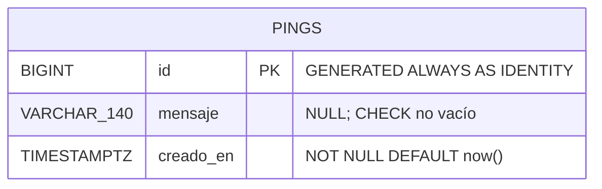
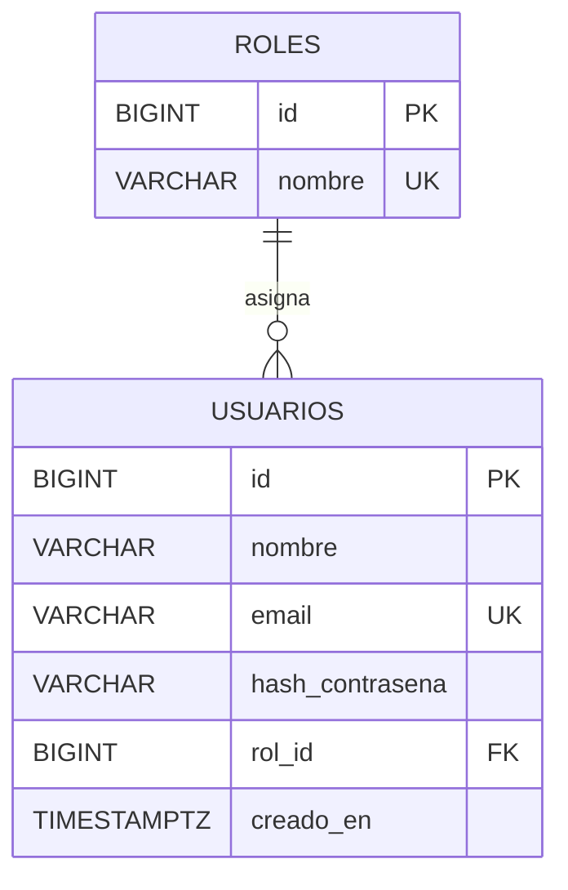

# Modelo de datos

## Plantilla base

| Columna | Tipo | Restricciones | Por qué |
|---|---|---|---|
| `id` | `BIGINT` | `PRIMARY KEY`, identidad | Clave sustituta asignada por la base |
| `mensaje` | `VARCHAR(140)` | Admite `NULL`; `CHECK` no vacío | Opcional; "sin mensaje" es `NULL`, no `''` |
| `creado_en` | `TIMESTAMPTZ` | `NOT NULL DEFAULT now()` | La base registra el instante exacto con zona horaria |

Índice: `ix_pings_creado_en (creado_en DESC)`, para el listado ordenado por fecha.

## Evolución en el taller práctico

Al terminar las tres partes del taller, el modelo queda así (ilustrativo; los
nombres exactos los define el capítulo 6 del manual):

